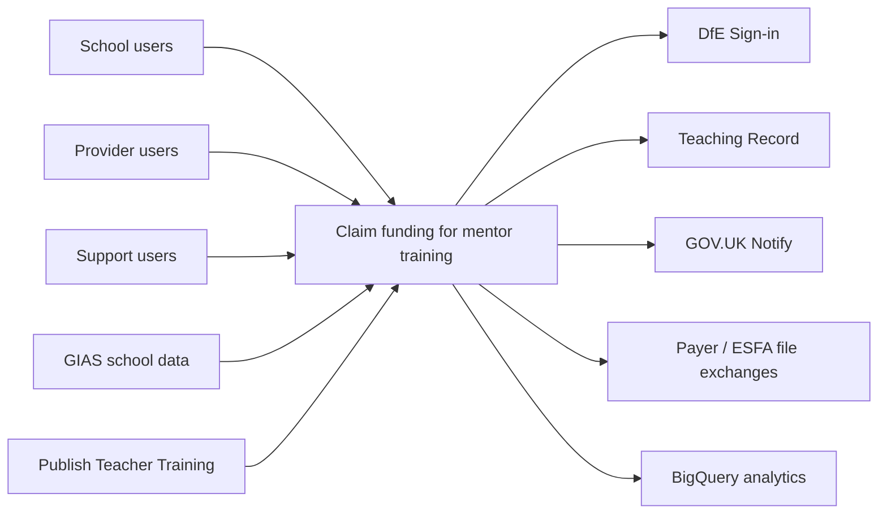
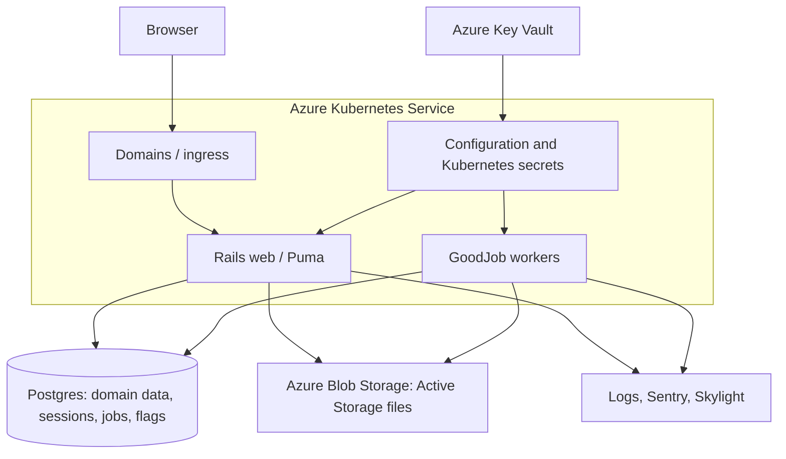

# Claims architecture

[Claims documentation](README.md)

## Service boundary

Claim funding for mentor training lets schools claim funding for mentor training. Provider users respond to sampling requests. Support users manage schools, claims, payment exchanges and assurance.

The [README](../../README.md) identifies claims as the current service. The repository retains placements routes, classes and tables from the historical shared-codebase design. Do not remove or assume isolation from that code when changing shared models. See [ADR 2](../../adr/00002-use-single-code-base-for-two-services.md).

Arrows show interactions or data direction, not synchronous calls or network access rules. [Integrations](integrations.md) explains the transports.

## Runtime

This is a logical runtime view. Managed database deployment, replica counts, hostnames and enabled monitoring vary by environment. Read [application Terraform](../../terraform/application/application.tf), [database Terraform](../../terraform/application/database.tf) and [environment configuration](../../terraform/application/config/) before making changes.

GoodJob uses Postgres rather than a separate Redis queue. Web and workers use the same application image and configuration. Web and worker modules depend on the migration job. Production Rails mode uses Azure Blob Storage. See [deployment](deployment.md).

## Code map

| Layer | Responsibility / source |
| --- | --- |
| Routing | [Shared routes](../../config/routes.rb), [claims host-constrained routes](../../config/routes/claims.rb), [host selection](../../lib/hosting_environment.rb) |
| Identity | [DfESignInUser](../../app/models/dfe_sign_in_user.rb), [OmniAuth](../../config/initializers/omniauth.rb) |
| Authorisation | [Claims base controller](../../app/controllers/claims/application_controller.rb), [claims policies](../../app/policies/claims/) |
| Domain | [Claims models](../../app/models/claims/) over shared database tables |
| Journeys | [Claims wizards](../../app/wizards/claims/), [BaseWizard](../../app/wizards/base_wizard.rb), [controllers](../../app/controllers/claims/) |
| Side effects | [Claims services](../../app/services/claims/) and [jobs](../../app/jobs/claims/) |
| Presentation | [Claims views](../../app/views/claims/), [components](../../app/components/), [JavaScript](../../app/javascript/) |
| Contracts and behaviour | [Request specs](../../spec/requests/), [system specs](../../spec/system/), [model specs](../../spec/models/claims/) |

Claims base controllers require explicit Pundit authorisation. Shared suggestion controllers inherit the shared authentication filter instead. Do not assume every `/api` route uses the claims controller hierarchy.

## Stack and design guidance

Ruby, Rails, Postgres, Stimulus, GOV.UK components, Sass and esbuild are declared in the [Gemfile](../../Gemfile), [package manifest](../../package.json) and [Dockerfile](../../Dockerfile). Use these files and the [tool manifest](../../.tool-versions) for supported versions.

Wizards hold journey state in the session. An `internal_draft` status and cleanup job also remain in the application. Inspect the specific journey rather than inferring its persistence behaviour from the general wizard ADR.

Read [conventions](../conventions.md), the [ADR index](../../adr/README.md), [data model](data-model.md) and [claim lifecycle](claim-lifecycle.md) next.
