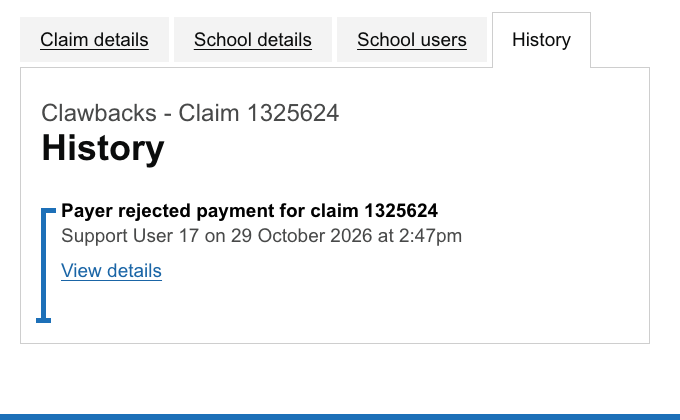
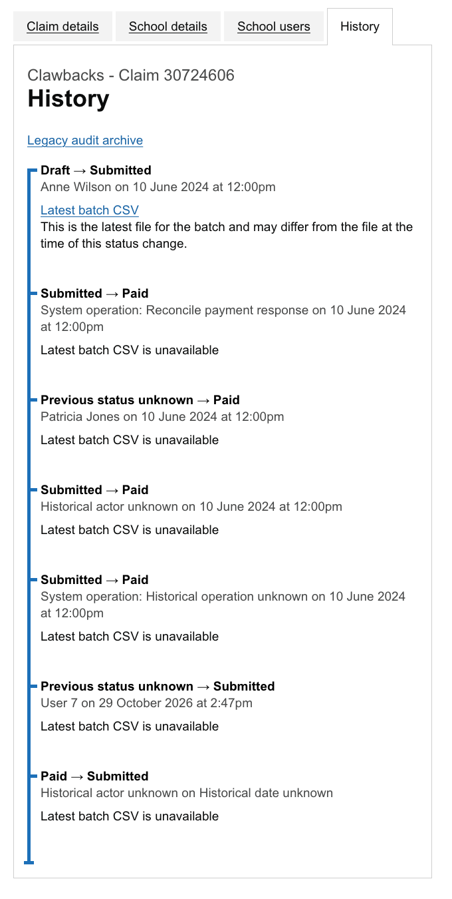

# Importing existing claim history and deploying the new view

Use this runbook to copy confirmed status changes from the existing logs into the new claim history and check that no evidence has been lost. The import is called a **backfill**. The checks that compare the result with the original records are called **reconciliation**.

Deployment replaces the support history view immediately. There is no feature flag or fallback to the old view. Plan a deployment window that pauses affected changes and support access while the team imports and checks the older records. Reopen access only when the checks below pass and the responsible team has reviewed any gaps.

This document provides instructions, not approval to run them in production. Production work needs separate operational approval.

## Support history preview

These screenshots use test data, including examples with missing historical details. They show the old and new views, not one real claim's history.

| Before deployment: activity history | After deployment: status history |
| --- | --- |
|  |  |

## What must be preserved

- Keep all original records and files: claim and mentor-training audits, activity logs, payment and other batch records, and attachment details. Neither the import nor its checks may update or delete them.
- Import only recorded claim status changes. Do not guess who made a change, when it happened or which file belongs to it from nearby timestamps, current values or CSV contents.
- Leave initial draft preparation in the archive. Include later returns to draft once a claim has been submitted.
- Keep activities and files that cannot be linked to a particular claim available through the existing service-wide or source views. Report the missing link rather than inventing one.
- Keep the original claim and mentor-training audit contents and activity details available in each claim's legacy archive.
- Keep audit history when a claim is deleted. Report records whose claim has been removed as orphaned evidence; do not attach them to a replacement claim. Non-production reset tooling explicitly clears these records before resetting claims.
- Keep the existing file-replacement behaviour. If a batch stores only its latest file, this change does not recover or preserve earlier versions.

## Prepare the deployment window

1. Rehearse on a restored, representative dataset. Estimate the number of records, page size and time needed to check files. Agree who will review gaps and where the reports will be stored.
2. Pause affected status changes, related record and file updates, and support access. Drain old status-writing jobs or confirm they are compatible with the new recording requirements.
3. Deploy the new schema and code. The new history replaces the old view on all four support claim-detail pages as soon as the release is serving requests; there is no separate activation step.
4. Confirm status recording is available. Keep affected writes and support access paused while capturing the baseline, importing history and running the final checks. Do not allow status changes without audit recording.

## Capture a baseline

A baseline is a saved description of the original evidence, used to check the import later. Run a dry run with a fixed page size and save its complete JSON output in a durable, restricted location approved by the service team:

```sh
bundle exec rake claims:claim_auditing:backfill DRY_RUN=true LIMIT=500
```

The dry run does not write to the database. Its report includes:

- `high_water_mark`: the highest audit ID included, which fixes the range for the import.
- `last_audit_id`: the point from which a later page can resume.
- Classifications of the records found and a `source_snapshot` describing the evidence.
- Record identifiers and SHA-256 fingerprints, which detect changed record contents, plus attachment IDs, checksums, sizes and whether files exist.

The report contains internal record identifiers and must not be stored in public artifacts or temporary storage that may be cleared.

For a single-claim investigation, use `CLAIM_ID=<uuid>` consistently for the dry run, import and checks. Before reopening the service after deployment, check the whole captured dataset; one claim is not enough.

## Import the older status changes

Start at the beginning of the captured range, using the exact `high_water_mark` from the baseline:

```sh
bundle exec rake claims:claim_auditing:backfill \
  DRY_RUN=false LIMIT=500 HIGH_WATER_MARK=<captured-high-water-mark>
```

For each later page, use the same upper audit ID and the previous page's `last_audit_id`:

```sh
bundle exec rake claims:claim_auditing:backfill \
  DRY_RUN=false LIMIT=500 AFTER_AUDIT_ID=<last-audit-id> \
  HIGH_WATER_MARK=<captured-high-water-mark>
```

Each imported entry keeps a unique link to its original audit in `legacy_audit_id`, so retries do not duplicate it. An existing matching entry is treated as already present. If an entry disagrees with its source, or a status audit cannot be classified, the import raises an error. Investigate the error; do not edit the original audits to make the import pass.

After the final page, repeat the import from the beginning with the same upper audit ID. It must add no further entries. Keep the page reports with the original dry-run report.

## Check the result before reopening access

Run reconciliation using the saved dry-run JSON report:

```sh
bundle exec rake claims:claim_auditing:reconcile \
  BASELINE_FILE=<restricted-dry-run-report.json>
```

These checks do not change data. They compare the imported entries with the original audits, check for duplicates, compare source records and attachment links, and read each available file to check its contents against its stored Active Storage checksum.

The command fails if it finds unexplained omissions, altered original records, files lost since the baseline, changed file contents or unclassified exceptions. A file already missing when the baseline was captured is reported as an existing gap, not as recovered.

Missing historical names or dates, initial draft history, records for deleted claims, unlinked evidence and current statuses not represented in the history are reported for review. The checks do not invent entries to fill those gaps.

Reopen affected writes and support access only when all of these are true:

- The second backfill adds zero events.
- Reconciliation exits successfully against the retained baseline.
- There are no unexplained missing records, duplicate entries, disagreements with source records, files lost since the baseline or failed file checksums.
- The responsible operational team has reviewed and recorded the reported historical gaps.
- Any disagreement with a claim's current status, or a non-draft claim with no history entry, has been reviewed as a gap rather than "fixed" by inventing a change.
- Support users can see the timeline, legacy archive and linked files, and other users cannot access them.

There is no feature flag to enable. The deployed release already uses the new view. Keep the reports and original evidence access-controlled.

The baseline checks what happened during this deployment window; it is not a permanent copy of each file version. Later batch resends may legitimately replace a file. For later checks, capture a new approved baseline at the agreed starting point and account for normal file replacements. Do not describe those replacements as files lost during migration.

## Rollback and retention

If the timeline is incorrect, keep support access paused or restrict it again while deploying a correction. There is no flag or old-view fallback. Do not roll back to code that permits unaudited status changes: keep recording active, or pause affected writes until it can be guaranteed.

Do not drop the new table, remove imported entries, or delete or rewrite original audits, activities, batches or files. Check changes made since deployment before changing the recording code or rolling back a release. Retain the original evidence through the agreed rollback window and follow the existing data-retention policy.

These are deployment instructions. Adding them does not run a production import, perform checks or grant operational approval.
