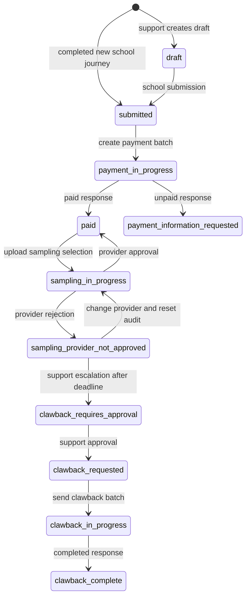
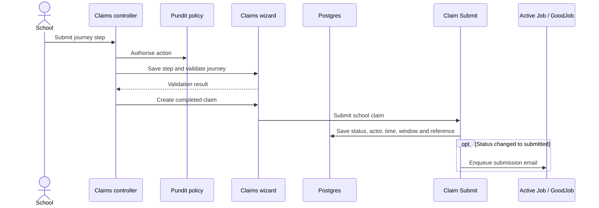
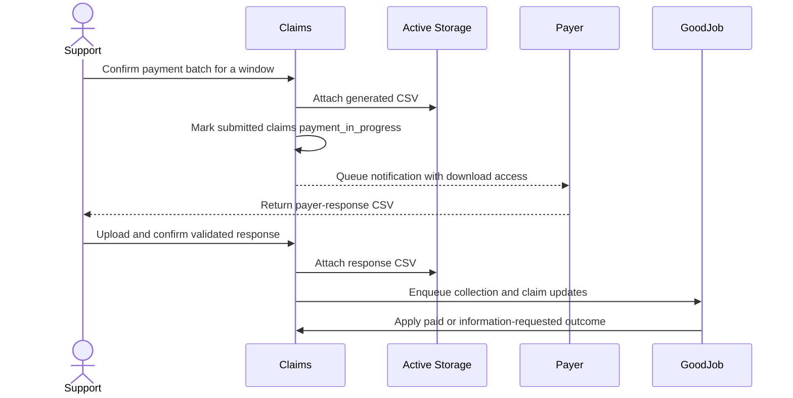

# Claim lifecycle and financial exchanges

[Claims documentation](README.md)

## Eligibility and training rules

School creation requires a current claim window and school eligibility under [ClaimPolicy](../../app/policies/claims/claim_policy.rb). School journeys also check acceptance of grant conditions. Support journeys have their own [policy](../../app/policies/claims/support/claim_policy.rb); they are not simply the school journey with unrestricted permissions.

[ClaimWindow](../../app/models/claims/claim_window.rb) uses inclusive dates and rejects overlapping windows. Eligibility relates schools to academic years, then to that year's windows.

[TrainingAllowance](../../app/models/claims/training_allowance.rb) calculates allowance per mentor, provider and academic year across claims, not per school independently. Previous non-draft training determines initial versus refresher training. Current-year hours exclude internal drafts and payment-not-approved claims; a claim being edited can be excluded explicitly.

[TrainingHours](../../app/models/claims/training_hours.rb) selects the initial allowance using the academic year's start date: before 1 January 2025 is 20 hours; otherwise 16. Refresher allowance is 6. These are current implementation rules, not a promise about future policy. The [hours spec](../../spec/models/claims/training_hours_spec.rb) examples cover earlier and later years; its context labels do not define the exact boundary.

## Main lifecycle

This diagram covers the principal normal path. Arrows name the operation, not a universal model state-machine guard. Controllers, policies, wizards and jobs enforce different preconditions.

Sources: [claim services](../../app/services/claims/claim/), [payment batch](../../app/services/claims/payment/create_and_deliver.rb), [sampling batch](../../app/services/claims/sampling/create_and_deliver.rb), [clawback batch](../../app/services/claims/clawback/create_and_deliver.rb), [payer-response job](../../app/jobs/claims/payment/update_claim_with_payer_response_job.rb).

Payment-information follow-up is a separate support flow:

| From | Action / result | Evidence |
| --- | --- | --- |
| `payment_information_requested` | Confirm information sent: `payment_information_sent` | [Payment support controller](../../app/controllers/claims/support/claims/payments/claims_controller.rb) and [policy](../../app/policies/claims/support/claims/payments/claim_policy.rb) |
| `payment_information_sent` | Confirm payment: `paid` | Same controller/policy; records a business activity |
| `payment_information_requested` or `payment_information_sent` | Reject payment: `payment_not_approved` | Same controller/policy; records a business activity |
| `invalid_provider` | Select a replacement provider and resubmit: `submitted` | [InvalidProviderWizard](../../app/wizards/claims/invalid_provider_wizard.rb) and [school ClaimPolicy](../../app/policies/claims/claim_policy.rb) |

Manual payment confirmation is a different implementation path from the paid CSV response service. Do not assume it applies the same payment-detail or notification updates.

Other persisted states include `internal_draft`, `payment_information_sent`, `payment_not_approved`, `sampling_not_approved`, `invalid_provider` and `clawback_rejected`. See the [complete enum](../../app/models/claims/claim.rb) and [support routes](../../config/routes/claims.rb). Their existence does not imply a linear path through them. Exceptional support submissions can create submitted or already-paid historical claims through [SubmitOnBehalfOfSchool](../../app/services/claims/claim/submit_on_behalf_of_school.rb). That service requires payment details for paid claims and suppresses the normal paid notification by marking it sent.

## Submission sequence

[Submit](../../app/services/claims/claim/submit.rb) keeps an existing reference, assigns the current window when available and sends email only when status changes to submitted. See [submission tests](../../spec/services/claims/claim/submit_spec.rb). Controller/wizard responsibilities vary by journey; follow the actual controller before changing persistence.

This sequence follows the completed school [add-claim controller](../../app/controllers/claims/schools/claims/add_claim_controller.rb) and [wizard](../../app/wizards/claims/add_claim_wizard.rb). Provider approval/rejection has an additional identity restriction: the [provider policy](../../app/policies/claims/providers/claim_policy.rb) disallows auditing a claim created by the same person, including matching identities across roles.

## Payment and assurance exchanges

The payer exchange is file-based, not an inbound payment webhook. Outgoing payment and clawback batches create business activity records and queue email after transaction commit. An uploaded response being saved does not mean all async claim updates have completed.

| Exchange | Current contract / effect |
| --- | --- |
| Payment request | [Generator](../../app/services/claims/payments/claim/generate_csv_file.rb) defines columns including reference, school identifiers, provider, amount, submission date, status and unpaid reason. Amount is formatted in pounds. |
| Payer response | Required headers: `claim_reference`, `claim_status`, `claim_unpaid_reason`, `claim_paid_to_la`, `claim_date_paid`. Status must be lowercase `submitted`, `paid` or `unpaid`. Reference must identify a payment-in-progress claim. Unpaid requires a reason. Paid requires a recognised yes/no or true/false LA flag and a parseable payment date. |
| Sampling selection | Required headers: `claim_reference`, `sample_reason`. References must identify paid claims; reasons are required. Claims are grouped by provider and provider users are notified. |
| Clawback request | [Generator](../../app/services/claims/clawback/generate_csv_file.rb) includes original and clawback amounts. Sending moves requested claims to in-progress. |
| Clawback response | Required headers: `claim_reference`, `claim_status`. Status must be `clawback_in_progress` or `clawback_complete`; references must identify in-progress clawbacks. Only completion rows cause completion jobs. |

The upload steps require MIME type `text/csv`, parse with the configured CSV encoding and ignore rows with blank references. Review the [payer](../../app/wizards/claims/upload_payer_payment_response_wizard/upload_step.rb), [sampling](../../app/wizards/claims/upload_sampling_data_wizard/upload_step.rb) and [clawback](../../app/wizards/claims/upload_esfa_clawback_response_wizard/upload_step.rb) validators before preparing a file.

**The payment export is not a ready-to-reupload payer response.** Its generator does not include the two required payment-detail response columns. Obtain the agreed response file from the authorised payer process.

The payer-response job handles `paid` and `unpaid`; a `submitted` response leaves the claim in progress. Both collection and individual jobs restrict payment updates to payment-in-progress claims. See [job tests](../../spec/jobs/claims/payment/update_claim_with_payer_response_job_spec.rb).

## Amendments, failure and reprocessing

Provider rejection records mentor-level assurance details and an amendment notification time. The [claim](../../app/models/claims/claim.rb) computes a 30-day amendment deadline and moves weekend deadlines to the next weekday. Support escalation checks that the deadline has passed. [Changing provider](../../app/services/claims/claim/change_provider.rb) recalculates claimable hours, can remove zero-hour training rows, resets assurance data and reissues sampling for audit states.

Before retrying a file or job, compare the activity record, attached file, current claim status, job results and notifications already sent. Do not assume whole-file atomicity or exactly-once processing. Do not directly edit status in a console to bypass validation.

Register supplies eligibility data by manual request. Policy sets claim windows and the other financial-process dates. The multi-year calendar was still being agreed at the October 2026 handover.

> **Needs to be found.** Publish agreed dates and confirm file delivery ownership, response date format, duplicate-row handling expectations and reconciliation controls. Retry or financial correction procedures need authorised non-production rehearsal.

For diagnostics use [operations](operations.md) and [troubleshooting](troubleshooting.md).
