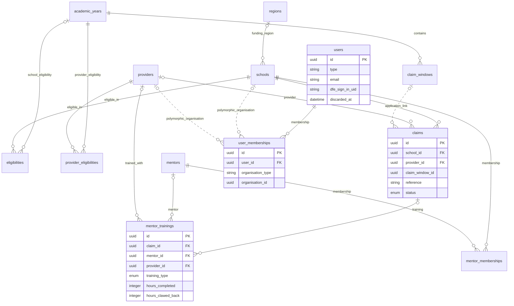
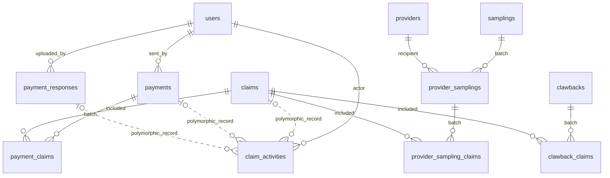

# Claims data model

[Claims documentation](README.md)

The [schema](../../db/schema.rb) is the source of truth for columns, nullability, indexes and database foreign keys. The [models](../../app/models/claims/) define additional application-level relationships and validations. These diagrams show physical table names and selected fields, not every column.

Solid relationships below denote relationships present in the schema as foreign keys. Dotted relationships denote application-only links, including polymorphism. End markers describe database nullability, not Rails validation. No join uniqueness is implied by a line.

## Core ERD

For polymorphic organisation links, zero-or-one at each parent end means the row refers to that parent type or the other type. It does not mean `organisation_id` is nullable.

## Payments and assurance ERD

The activity diagram shows representative record types, not an exhaustive polymorphic target list. Payment responses attach their uploaded CSV, but have no direct claim join in the schema. Active Storage attaches files to records polymorphically through `active_storage_attachments`, with blob metadata in `active_storage_blobs`. Restoring database metadata without its blobs is insufficient.

## Data dictionary

All domain tables shown use UUID primary keys. Framework tables such as sessions and audits have different identifiers.

| Table / model | Meaning and important invariants |
| --- | --- |
| `academic_years` | Date boundaries group eligibility, claims and training allowances. |
| `claim_windows` / `Claims::ClaimWindow` | Required year and start/end dates. Rails rejects overlapping windows. Current includes both boundary dates. Discarded windows are hidden by default. |
| `eligibilities` / `Claims::Eligibility` | School eligibility for an academic year, not a direct school-to-window join. `academic_year_id` is nullable in the schema; its foreign key is declared with `validate: false`. |
| `provider_eligibilities` | Required provider/year pair with a unique composite index. Provider suggestions use this, not just `accredited`. |
| `schools` / `Claims::School` | Shared school records; URN has a unique index. Claims default scope selects claims-onboarded schools. Region holds the hourly funding rate. |
| `providers` / `Claims::Provider` | Shared provider records; `code` is uniquely indexed. Do not confuse provider eligibility with the placements onboarding flag. |
| `mentors` / `Claims::Mentor` | Shared mentor records with required, uniquely indexed TRN. Service subclasses do not imply a separate table or a `type` column. |
| `mentor_memberships` | School/mentor relationship. `type` distinguishes service-specific membership classes; `(type, school_id, mentor_id)` is unique. |
| `users` | STI `type` distinguishes school, provider and support identities. `(type, email)` is unique. A person can have multiple role records. `discarded_at` supports soft deletion. |
| `user_memberships` | User-to-organisation link; organisation is polymorphic. `(user_id, organisation_id)` is uniquely indexed. No database foreign key enforces the polymorphic organisation. |
| `claims` | Status enum, reference, school/provider/window and submission details. School is non-null; provider/window columns permit null at database level. Reference uniqueness is a Rails validation; its schema index is not unique. |
| `mentor_trainings` | Hours and training type per mentor/provider/claim; rejection, assurance and clawback information. Foreign key columns allow null at database level; check model validations before constructing records. |
| `payments`, `payment_claims` | Outgoing payment batch, sender, download timestamp and included claims. |
| `payment_responses` | Uploading user, processing/download flags and CSV attachment. Async jobs perform claim changes separately. |
| `samplings`, `provider_samplings`, `provider_sampling_claims` | Sampling run, per-provider grouping and included claims. |
| `clawbacks`, `clawback_claims` | Request/response files and associated claims. |
| `claim_activities`, `audits` | Business activity records and model audit history. Claims are audited; activity records also track financial exchanges. These are not a complete security-event log. |
| `sessions`, `good_jobs`, `flipper_features`, `flipper_gates` | Runtime state in the same database. Recovery can replay or resurrect work and flags. |

`created_by` and `submitted_by` on a claim are polymorphic application associations. Other claim actor IDs are also application associations without schema foreign keys. Read [Claims::Claim](../../app/models/claims/claim.rb) rather than assuming every `belongs_to` has database enforcement.

## Funding and deletion

Amounts are computed from the school's region rate in pence and the sum of training hours. See [regional calculations](school_region_calulations.md) and [TrainingAllowance](../../app/models/claims/training_allowance.rb). The calculation reads the current associated region rate; do not assume an immutable amount snapshot.

Deleting a claim destroys its mentor trainings and assurance/clawback associations as defined in the model. [School deactivation](../deactivate-school.md) deletes more data and is not an ordinary account-disable operation.

Retention/deletion and data-sharing documents are being developed, as reported at handover. No approved policies were supplied.

> **Needs to be found.** Link approved retention, archival, deletion and audit preservation requirements when available. Database schema and Rails callbacks are not policy.

Review this page whenever migrations, associations, scopes or indexes change. See [schema](../../db/schema.rb), [claim model specs](../../spec/models/claims/claim_spec.rb) and [recovery](disaster-recovery.md).
