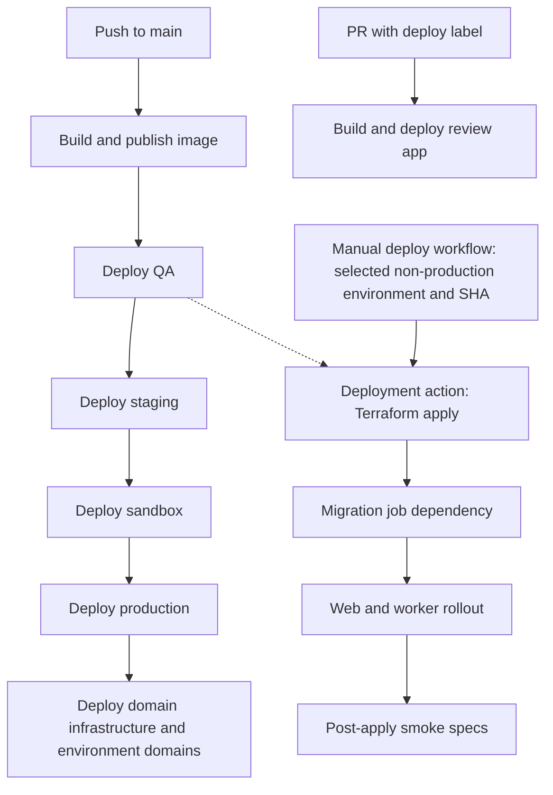

# Environments and deployment

[Claims documentation](README.md)

## Environment inventory

Production's canonical sign-in URL is https://claim-funding-for-itt-mentor-training.service.gov.uk/sign-in, confirmed during the handover interview on 29 October 2026. The former `claim-funding-for-mentor-training.education.gov.uk` address is not a supported alias. Environment URLs below follow checked [environment YAML](../../terraform/application/config/); they are not live reachability checks. Domain Terraform still includes legacy redirects. Platform owners should reconcile that configuration with the stated support boundary before changing traffic.

| Environment | Documented public URL | Configured application host | Cluster / namespace | Sign-in |
| --- | --- | --- | --- | --- |
| Production | https://claim-funding-for-itt-mentor-training.service.gov.uk | `claim-funding-for-itt-mentor-training.service.gov.uk` | `production` / `bat-production` | DfE Sign-in |
| Sandbox | https://sandbox.claim-funding-for-itt-mentor-training.service.gov.uk | `sandbox.claim-funding-for-itt-mentor-training.service.gov.uk` | `production` / `bat-production` | Persona |
| Staging | https://staging.claim-funding-for-itt-mentor-training.service.gov.uk | `staging.claim-funding-for-itt-mentor-training.service.gov.uk` | `test` / `bat-staging` | DfE Sign-in |
| QA | https://qa.claim-funding-for-itt-mentor-training.service.gov.uk | `qa.claim-funding-for-itt-mentor-training.service.gov.uk` | `test` / `bat-qa` | Persona |
| PR review | Generated per PR; use deployment output | Generated ingress host | `test` / `bat-qa` | Persona |
| Development review | Generated; use deployment output | Generated ingress host | Selected development cluster / `development` | Persona |
| Platform-test review | Generated; use deployment output | Generated ingress host | `platform-test` / `development` | Persona |

Sources: [application configuration](../../terraform/application/config/), [domain configuration](../../terraform/domains/environment_domains/config/), [Makefile](../../Makefile), [hosting rules](../../lib/hosting_environment.rb).

Sandbox shares the production cluster/namespace, but is a separate environment. Do not select a deployment by namespace alone.

## Build and promotion

The solid promotion chain summarises the ordered environment matrix and job dependencies, not environment approval settings. The dotted line expands the common deployment action, which is also used by the other environment deployments.

[Build and deploy](../../.github/workflows/build_and_deploy.yml) runs on main pushes and selected pull-request events. A labelled PR can deploy a review app. Main deployments run non-production environments sequentially, then production, then domain deployment.

### Review, merge and CI safeguards

The team confirmed this process at handover:

1. Create a PR review environment for product review.
2. Obtain product review and approval from a second developer. Any other developer can perform the developer review.
3. Click Merge manually. There is no further manual approval reported after merge; the main-push pipeline then runs.

Failures in Terraform/Kubernetes setup or smoke tests stop the deployment job and prevent further promotion. Non-production deployment failures block production deployment. Changes already applied are not automatically undone: production smoke tests run after deployment, and their failure may require recovery through the documented PR-revert process.

[Build and test](../../.github/workflows/build_and_test.yml) is separate from build/deploy, and the checked deploy workflow does not explicitly depend on its result. Branch protection and runtime rollout safeguards were not independently checked. These remaining controls need verification under [G4](documentation-audit.md#team-input-register).

The [Dockerfile](../../Dockerfile) builds dependencies/assets and a non-root runtime image. The [Makefile](../../Makefile) identifies the image repository. Use manifests for runtime versions, not this guide.

The [deployment action](../../.github/actions/deploy-environment/action.yml) authenticates to Azure and Google, applies Terraform using the image tag, extracts ingress hosts and runs smoke specs. [Web and worker](../../terraform/application/application.tf) depend on the [migration job](../../terraform/application/job.tf). A failed post-apply smoke test does not mean Terraform changes were rolled back.

## Deployment procedure

Prerequisites: approved target environment, GitHub/cloud access, reviewed code/image, compatible migrations and a clear operational owner.

1. Review relevant CI checks and the exact commit/image.
2. Select the normal promotion route. For non-production redeployment, inspect the [manual workflow](../../.github/workflows/deploy.yml) inputs: environment, SHA, and PR/cluster details when relevant.
3. Check migration and storage/secret changes before applying.
4. Observe workflow results, migration job, web/worker rollout and post-apply smoke tests.
5. Verify `/healthcheck`, `/healthcheck/database` and `/healthcheck/sha` on the intended host. Confirm SHA, sign-in, a read-only claims journey and queue health.
6. If validation fails, keep the incident/deployment owner informed. Decide on maintenance, a forward fix or rollback before another deployment.

Expected result: intended SHA serving the correct environment with healthy database, web and workers. Do not run deployment commands merely to validate this documentation.

## Maintenance and rollback

Use the [incident cheatsheet](../incident-cheatsheet.md) for staging/production maintenance mode and temporary ingress access.

The team's rollback approach is to revert the failing PR and deploy the revert through the normal pipeline. Review migration and data compatibility before doing so. The manual deploy workflow does **not** offer production. Do not use it as an assumed production rollback mechanism. Reverting code does not reverse schema/data changes, external payments or sent emails.

> **Needs to be found.** Rehearse the PR-revert procedure and document handling of irreversible migrations, criteria for disabling workers and smoke-test failure response. Verify CI gates and rollout safeguards under G4.

Deployment is event-triggered; observed release frequency, freeze periods and operational release schedules need team confirmation.

## Configuration changes

See [environment variables](../environment-variables-in-azure.md) for Key Vault and non-secret settings. Application and domain Terraform live separately under [terraform](../../terraform/). Do not apply domain or database changes as an incidental application troubleshooting step.
