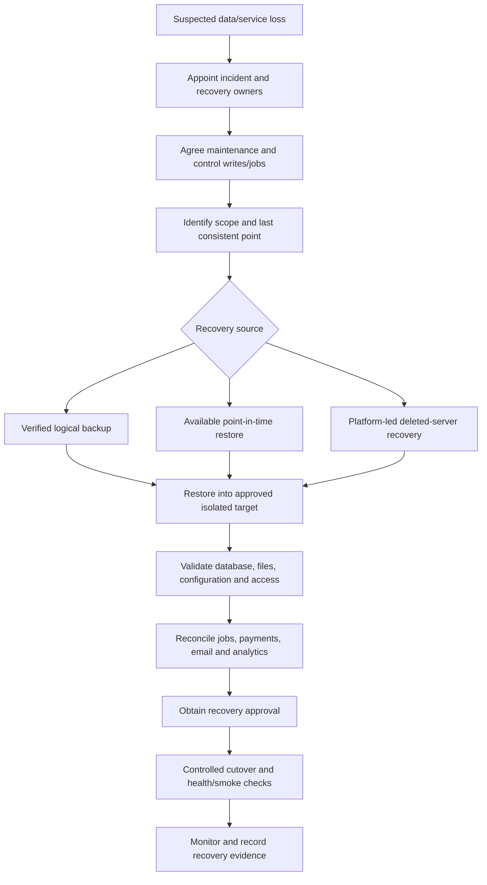

# Disaster recovery

[Claims documentation](README.md)

This is a repository-backed recovery checklist. The workflows below have **not** been executed as documentation validation. Do not treat this guide as evidence of a successful disaster recovery test.

## Recovery mechanisms

| Mechanism | Source / known behaviour | Still needs confirmation |
| --- | --- | --- |
| Scheduled logical database backup | [Backup workflow](../../.github/workflows/database-backup.yml): production by default, daily at 03:00 UTC; manual environment/server/file selection available | Recent successful run, usable artefact, encryption/access and retention |
| Restore from storage | [Restore workflow](../../.github/workflows/postgres-restore.yml): selected environment, optional backup filename; explicit production confirmation | Verified file format/name, compatibility and tested restore duration |
| Point-in-time restore | [PTR workflow](../../.github/workflows/postgres-ptr.yml): UTC restore time and new server name; explicit production confirmation | Available retention window, server cutover and validation procedure |
| Deleted database recovery | [Workflow](../../.github/workflows/restore-deleted-postgres.yml) | Approved platform-led procedure and test evidence |
| File storage | [Azure Blob configuration](../../terraform/application/storage_account.tf), [Active Storage](../../config/storage.yml) | Independent recovery strategy and consistency with database restore |

Production storage config sets seven-day blob/container soft-delete retention. This is not a complete file backup policy or a database backup-retention statement.

Database provisioning uses a [shared Terraform module](../../terraform/application/database.tf). Confirm deployed backup policy and available restore points with platform operators; module arguments alone do not prove recoverability.

## Reported recovery arrangements

The team supplied the following on 29 October 2026. These are reported arrangements, not independently verified recovery evidence:

- The team confirmed daily database backups are scheduled for **03:00 UTC**, matching the checked workflow.
- The last DR exercise was approximately autumn 2025. No report, exact date or results are currently available.
- No RTO or RPO has been agreed.
- GoodJob jobs are database-backed. Restoring a database can restore incomplete job records, subject to the selected restore point. It does not guarantee safe or exactly-once continuation.
- Secrets are held separately in Azure Key Vault. There is no secret-recovery guide available at handover.
- There is no file-recovery plan.
- Recovery and financial reconciliation ownership is unconfirmed. The policy team was suggested as a possible owner, not assigned responsibility.

## Recovery decision flow

This flow is a proposed safety checklist. G5/G6 must be closed with an authorised rehearsal before it becomes a proven runbook.

## Recovery procedure and safeguards

Prerequisites: incident owner, approved target and recovery point, platform access, data handling approval, known backup/restore evidence and a rollback/cutover plan. Production confirmation inputs are an extra guard, not a substitute for change approval.

1. Identify whether the problem affects the database, blobs, infrastructure, configuration or external systems. Preserve diagnostics and the current state where practical.
2. Agree maintenance mode and write/worker controls with platform operators. Web maintenance alone does not stop jobs, imports or external effects.
3. Confirm the restore point and acceptable data loss with the service owner. Prefer an isolated target for validation.
4. Inspect the chosen workflow and actual backup artefact. The backup action receives a `.sql` filename; the restore workflow's default uses `.sql.gz`. Do not guess the stored extension or rely on its example filename.
5. For logical recovery, select the verified artefact and correct environment. For PTR, provide the UTC restore time and new server name. **PTR creates a new server; this workflow is not evidence of automatic application cutover.**
6. Validate schema and data, claim/window relationships, record totals and sampled references. Verify attachments against blob storage, not only attachment metadata.
7. Reconcile GoodJob records and schedules before resuming workers. Restored job state can repeat financial exports or notifications. Confirm claims already paid externally and emails already sent.
8. Re-establish approved configuration, database connectivity and analytics/replication state. Coordinate Airbyte and WAL handling with platform/data operators.
9. Obtain approval for controlled cutover. Verify SHA, database health, sign-in, authorised read-only journeys, blobs and workers. Keep maintenance until acceptance criteria are met.
10. Record actual data loss, timings, discrepancies, checks and approvals. Monitor after reopening. If validation fails, keep the target isolated and escalate rather than opening traffic.

Do not run restore or cutover commands from this checklist without the platform-approved environment-specific procedure.

## Required recovery evidence

> **Needs to be found.** Confirm successful backup runs, database/PITR retention, evidence for the reported autumn 2025 exercise, restore/cutover commands and encrypted backup access. Assign recovery/reconciliation owners and establish file/secret recovery procedures. RTO/RPO remain not agreed. Track [G5/G6](documentation-audit.md#team-input-register).

A non-production rehearsal should cover database plus blobs, jobs, credentials/configuration, authorisation, representative claims, financial side effects and analytics. Record measured results separately from target objectives.
