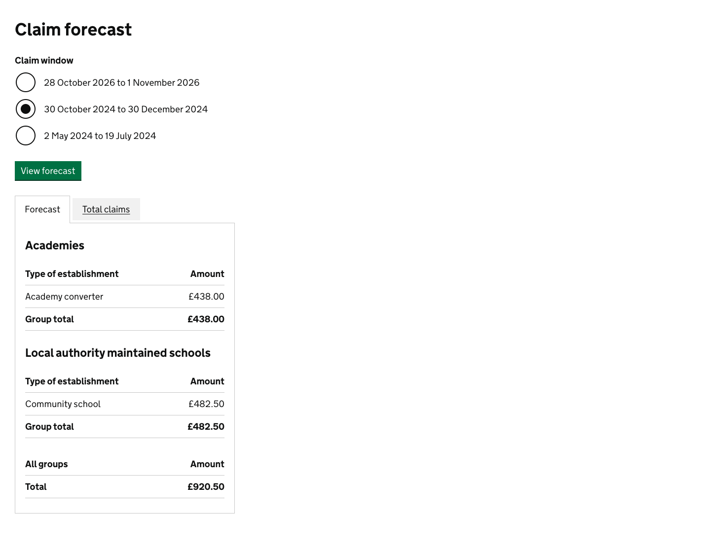
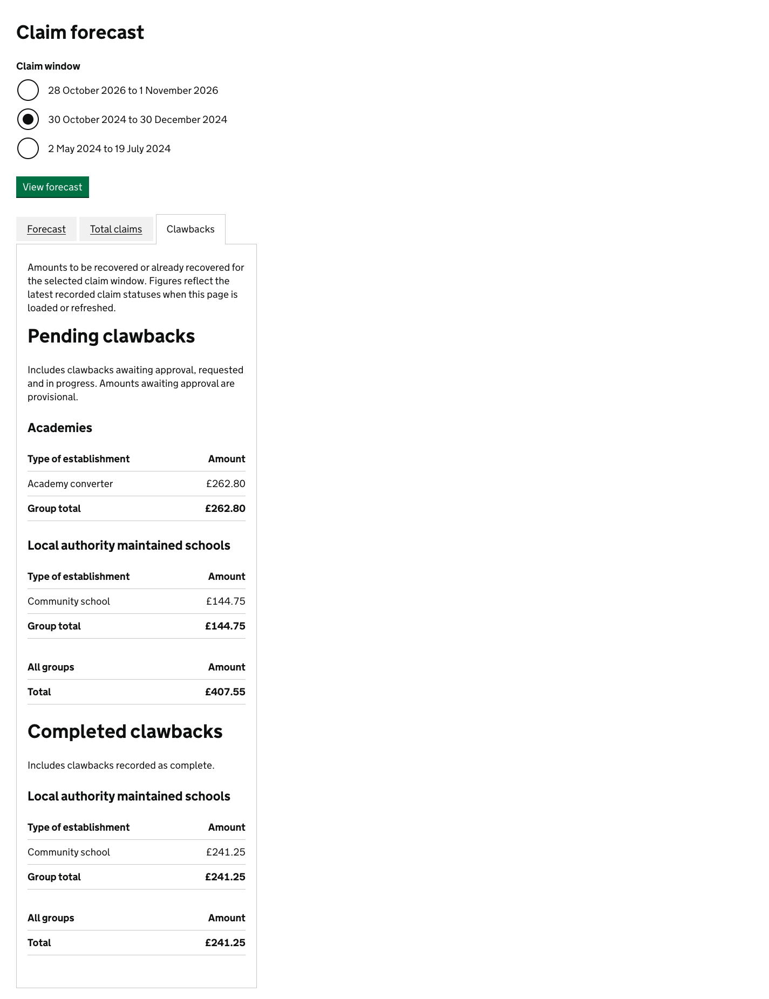

# Forecast and clawback reporting

Support users can select a claim window under **Settings > View claim forecast**. The [forecast page](../../app/views/claims/support/forecasts/show.html.erb) has three tabs:

- **Forecast**: original amounts for submitted claims.
- **Total claims**: original amounts for all non-draft claims, not just paid claims.
- **Clawbacks**: separate pending and completed recovery amounts, grouped by school group and establishment type.

Pending includes `clawback_requires_approval`, `clawback_requested` and `clawback_in_progress`; amounts awaiting approval are provisional. Completed includes `clawback_complete`. Rejected clawbacks and other statuses are excluded from the clawback figures. Recovery amounts use not-assured training hours clawed back multiplied by the school's regional funding rate, matching [the claim's recovery calculation](../../app/models/claims/claim.rb), rather than the original claim amount.

The [forecast service](../../app/services/claims/claim/forecast.rb) aggregates integer-pence amounts in the database with one query per report (four reporting queries per selected-window page), without loading individual claims or caching totals. Figures reflect persisted data when the page loads or is refreshed, not live updates while it remains open. Uploaded financial responses must finish asynchronous processing before their status changes appear.

All tabs use the selected claim window. As with the original forecast, amounts for schools missing their group or establishment type are excluded from totals.

## Screenshots

The following screenshots use synthetic system-test data at a 1440px desktop viewport.

### Before

### After

