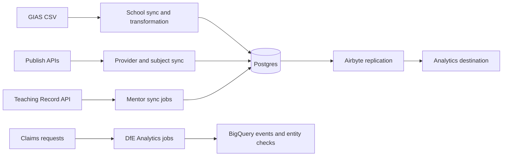

# Integration register

[Claims documentation](README.md)

Configuration names below identify settings, never credential values. Deployed secrets are managed through [Azure Key Vault and application configuration](../environment-variables-in-azure.md). Confirm external account access and ownership before handover.

| Dependency | Direction / purpose | Configuration and implementation | Failure and operational notes |
| --- | --- | --- | --- |
| DfE Sign-in | Browser OpenID Connect sign-in and logout | `SIGN_IN_METHOD`, `DFE_SIGN_IN_ISSUER_URL`, `CLAIMS_DFE_SIGN_IN_CLIENT_ID`, `CLAIMS_DFE_SIGN_IN_SECRET`; [OmniAuth](../../config/initializers/omniauth.rb), [hosting configuration](../../lib/hosting_environment.rb) | Confirm callback URLs and host before diagnosing credentials. Persona mode is a separate configured method, not an automatic outage fallback. |
| GIAS | Download school CSV, transform and import | `GIAS_CSV_BASE_URL`; [downloader](../../app/services/gias/csv_downloader.rb), [sync job](../../app/jobs/gias/sync_all_schools_job.rb) | Uses yesterday's dated file and ISO-8859-1 input. Check download, transformation and import logs separately. PROJ is required for coordinate conversion. |
| Publish Teacher Training | Import provider and subject reference data | `PUBLISH_BASE_URL`; [provider API](../../app/services/publish_teacher_training/provider/api.rb), [subject API](../../app/services/publish_teacher_training/subject/api.rb), [jobs](../../app/jobs/publish_teacher_training/) | Provider request uses the current academic year's recruitment cycle. Reference data import does not replace claims provider-eligibility onboarding. |
| Teaching Record | Lookup TRNs and refresh mentor names | `TEACHING_RECORD_BASE_URL`, `TEACHING_RECORD_API_KEY`, `TEACHING_RECORD_API_MINOR_VERSION`; [REST client](../../app/services/teaching_record/rest_client.rb) | Client distinguishes not-found from other HTTP errors. [Mentor sync](../../app/jobs/teaching_record/sync_mentor_job.rb) reports not-found to Sentry. Batch scheduling spaces groups of 300 mentors one minute apart; this is not a global rate limiter across every caller. |
| GOV.UK Notify | Transactional email | `GOVUK_NOTIFY_API_KEY`; [production mail settings](../../config/environments/production.rb), [mailers](../../app/mailers/), [rate limiter](../../app/services/notify_rate_limiter.rb) | Check job outcome, template and Notify delivery status before resending. Use a test key locally. |
| Payer / ESFA | Payment and clawback file exchange | [Batch services](../../app/services/claims/), [CSV and upload contracts](claim-lifecycle.md#payment-and-assurance-exchanges) | Application class names still use ESFA. Confirm the current business recipient, transport and service agreement with operations. |
| GOV.UK bank holidays | Fetch England and Wales holiday dates | [Client](../../lib/gov_uk/bank_holiday.rb), [sync job](../../app/jobs/bank_holidays/sync_job.rb) | Non-success HTTP responses raise. Needed for delivery scheduling; verify data freshness before changing schedules. |
| BigQuery / DfE Analytics | Async events, entity checks and reporting | `BIGQUERY_*` settings; [initializer](../../config/initializers/dfe_analytics.rb), [analytics configuration](../../config/analytics.yml) | Analytics uses the `dfe_analytics` queue and Azure federated authentication. Enablement depends on `HOSTING_ENV`. Analytics team owns analytics; developers own reporting. Dataset/access links remain outstanding. |
| Airbyte | Database replication to analytics | [Terraform](../../terraform/application/airbyte.tf), [stream configuration](../../terraform/application/config/airbyte_stream_config.json) | Separate replication path from application events. Monitor WAL and replication health before replay or resync. |
| Slack / Teams | Operational roundups and workflow notifications | [Slack notifier](../../lib/slack_notifier.rb), [claims notifiers](../../app/slack_notifiers/), [workflows](../../.github/workflows/) | Treat webhook URLs as secrets. A missing Slack endpoint skips delivery; absence of a message is not proof of health. |
| Sentry / Skylight / Logit / StatusCake | Errors, performance, logs, uptime and TLS checks | [Operations](operations.md#health-and-telemetry) | Configuration evidence is not proof that alert recipients or dashboards are correct. |

## Data flows

Arrows show logical data direction. Jobs initiate outbound requests to reference services. Airbyte provisioning and enablement are environment-specific.

## Retry and recovery boundaries

The [base Active Job class](../../app/jobs/application_job.rb) has no active generic `retry_on` or `discard_on` declaration. Do not assume comments there establish a retry policy. GoodJob behaviour, per-job handlers and the deployed adapter also matter.

The GIAS, Publish and Teaching Record wrappers do not establish a shared explicit timeout/retry contract. Check the exact client and library defaults before changing recovery behaviour. Do not re-run all syncs simply because one integration failed.

Before replaying analytics or financial work, determine what the external system already received. A database restore cannot unsend email or reverse payments.

## Ownership and manual data dependencies

The Analytics team owns analytics; developers own reporting. Register supplies eligibility data by manual request, separately from the automated GIAS/Publish reference-data imports. Policy owns the claim-window and financial-process dates; the multi-year calendar was still being agreed at the October 2026 handover.

Retention/deletion and data-sharing policies are in development, not supplied as approved. No credential-rotation or secret-recovery procedure was available.

> **Needs to be found.** Confirm other integration owners, external limits/SLOs, timeout expectations, failure escalation, reporting consumers, financial file owners/contracts and approved policies once available. See [G1, G7, G9 and G10](documentation-audit.md#team-input-register).
