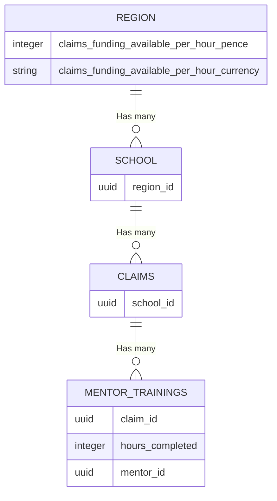

# School region calculations

[Claims documentation](README.md) / [Current data model](data-model.md)

Within the claims application, we have a need to calculate a schools funding per hour. This is so when a mentor completes their training we have a way to calculate their hourly rate, which they then can recoup.

```ruby
  region = claim.school.region
  claims_funding_available_per_hour_pence = region.claims_funding_available_per_hour_pence

  total_hours_completed = claim.mentor_trainings.sum(:hours_completed)

  amount_in_pence = claims_funding_available_per_hour_pence * total_hours_completed
```

The implementation is [Claims::Claim::CalculateAmount](../../app/services/claims/claim/calculate_amount.rb). It sums non-nil training hours, multiplies by the school's region rate in pence, and returns GBP `Money`. The rate is read from the associated region at calculation time, not stored as an immutable claim amount.

## Data model

The [schema](../../db/schema.rb) links schools to regions. Each region can have many schools. This is a focused conceptual diagram; see the [claims ERDs](data-model.md) for schema nullability and enforcement.



| claims.id | mentor_trainings.id | regions.claims_funding_available_per_hour_pence | mentor_trainings.hours_completed |
|-----------|---------------------|---------------------------------------------------|----------------------------------|
| 1         | 1                   | 4530                                             | 10                               |
| 1         | 2                   | 4530                                             | 5                                |

| claims.id | total_amount |
|-----------|--------------|
| 1         | 67,950       |

`total_amount` above is in pence: 15 hours at 4,530 pence per hour is GBP 679.50. Both training rows use the same school's region rate.

## Associating Schools to Regions

We have an overnight process which syncs across schools from GIAS, in this process it also does the associating of a School to a given Region. The way this is done is we use the Schools `district_admin_code` to define which Region it should go in. These are mapped out [here](https://github.com/DFE-Digital/itt-mentor-services/blob/main/app/services/concerns/regional_areas.rb) where each `district_admin_code` is related to a specific region.

## Calculating the hourly rate

Once association has taken place, `school.region.funding_available_per_hour` returns the hourly rate through the [Region model](../../app/models/region.rb). Training eligibility and available hours are separate rules, described in the [claim lifecycle](claim-lifecycle.md).
