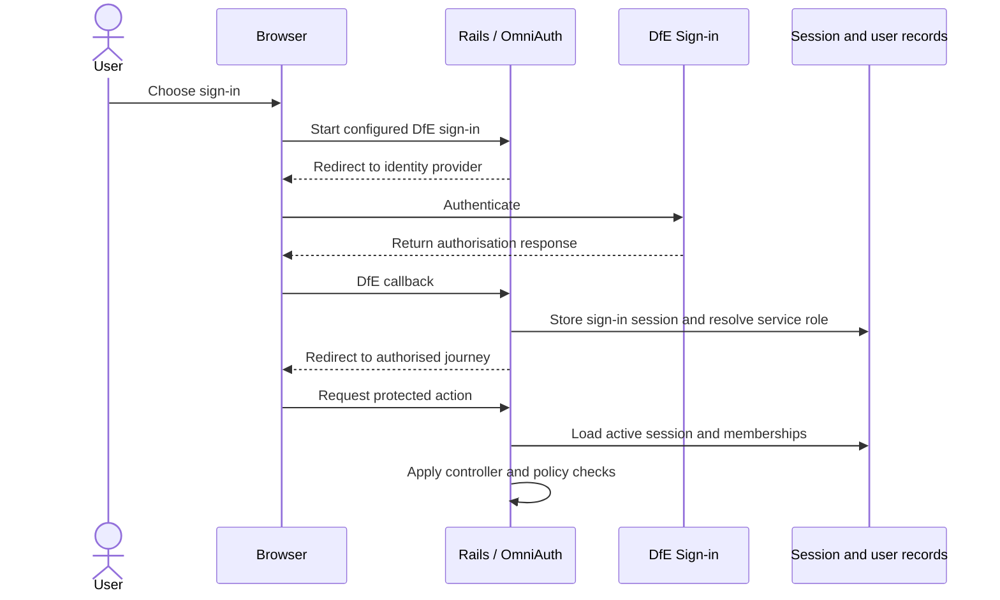

# Security and access handover

[Claims documentation](README.md)

This page records controls visible in the repository and assurance questions. It is not a penetration test, vulnerability assessment or compliance certification.

## Authentication and permissions

| Actor | Evidence-backed scope |
| --- | --- |
| School user (`Claims::User`) | Membership-scoped schools; school claim actions are controlled by [ClaimPolicy](../../app/policies/claims/claim_policy.rb) and grant-conditions checks |
| Provider user (`Claims::ProviderUser`) | Provider memberships and provider claim/sampling actions under [provider policies](../../app/policies/claims/providers/) |
| Support user (`Claims::SupportUser`) | Support controllers require `support_user?`; action-level [support policies](../../app/policies/claims/support/) still apply |
| Platform/deployment operator | Cloud and GitHub permissions, separate from application support access; request access through the service PM and activate production access through Azure PIM |

The access route above was confirmed at handover. [Azure connection guidance](../connect-to-azure.md) explains environment checks. PR changes require a review environment, product review and approval from a second developer; see [deployment](deployment.md#review-merge-and-ci-safeguards). Out-of-hours authorisation remains unconfirmed.

Provider approval and rejection also require sampling-in-progress state and forbid auditing a claim created by the same person. See the [provider claim policy](../../app/policies/claims/providers/claim_policy.rb); membership alone is not sufficient.

[DfESignInUser](../../app/models/dfe_sign_in_user.rb) resolves service-specific role records and gives support precedence. It also supports distinct school and provider identities for the same person. Session state is database-backed and expires after two hours of inactivity.

See [OmniAuth configuration](../../config/initializers/omniauth.rb), [sessions controller](../../app/controllers/sessions_controller.rb) and [shared controller](../../app/controllers/application_controller.rb).

`SIGN_IN_METHOD` chooses persona or DfE Sign-in. Configured production and staging use DfE Sign-in; QA and sandbox use personas. Persona is not an automatic fallback for a DfE outage. `/good_job` and `/flipper` require the [support route constraint](../../app/constraints/support_user_constraint.rb).

## Secrets and data handling

- Deployed secrets are stored/configured through [Azure Key Vault](../environment-variables-in-azure.md) and [application Terraform](../../terraform/application/application.tf). Do not put secret values in guides, tickets, sample requests or Mermaid blocks.
- Local `.env.*.local` files are ignored. Use test credentials and synthetic records. Do not assume every `.env.*` filename is ignored.
- [Production configuration](../../config/environments/production.rb) forces SSL and secure cookies. [Parameter filtering](../../config/initializers/filter_parameter_logging.rb) covers common sensitive names; it is not proof that all CSV content, exception messages or logs are anonymised.
- TRNs, identity/contact data, claim records, exports, audit history and analytics need appropriate access and retention controls. Blob containers are configured private in [storage Terraform](../../terraform/application/storage_account.tf).
- Confirm recipient identity before distributing financial exports. A database restore does not revoke already-downloaded files or unsend notifications.

## Vulnerability management and supply chain

[Dependabot](../../.github/dependabot.yml) configures weekly Bundler, npm and GitHub Actions updates. [Brakeman](../../bin/brakeman) is available in the repository. The [image build workflow](../../.github/workflows/build_and_deploy.yml) passes a Snyk token to the shared build action.

These facts do not establish scan success, blocking thresholds, remediation targets or coverage of every deployed image. The [Dockerfile](../../Dockerfile) runs as a non-root user; Terraform also has a runtime user setting.

The lead developer currently reviews vulnerability alerts and dependency updates. Automatic approval of dependency updates where possible is planned; it is not documented as an implemented control.

The team reports annual accessibility audits and penetration testing. Report links and findings were not supplied. No remediation targets, access-review cadence or credential-rotation procedures were supplied as established. SBOM availability remains unverified.

> **Needs to be found.** Obtain current scan/audit/test reports and SBOM evidence, confirm dependency/image provenance, and establish remediation, access review and credential rotation/revocation procedures.

Retention, deletion and data-sharing documents are being developed. None were supplied as approved at handover. Secrets are stored separately in Key Vault, but no secret-recovery guide is available.

> **Needs to be found.** Link approved policies and agreements when available, covering Teaching Record, Notify, financial exchanges, logs, backups and analytics. Establish secret-recovery guidance. Do not infer governance approval from an integration being configured.

Use [G1, G7 and G10](documentation-audit.md#team-input-register) to track sign-off. Review this page after authentication, policy, data-flow, secret-management or scanning changes.
